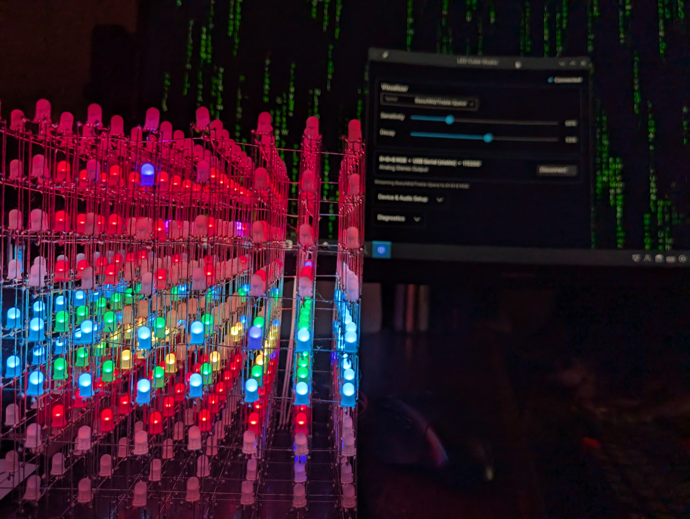
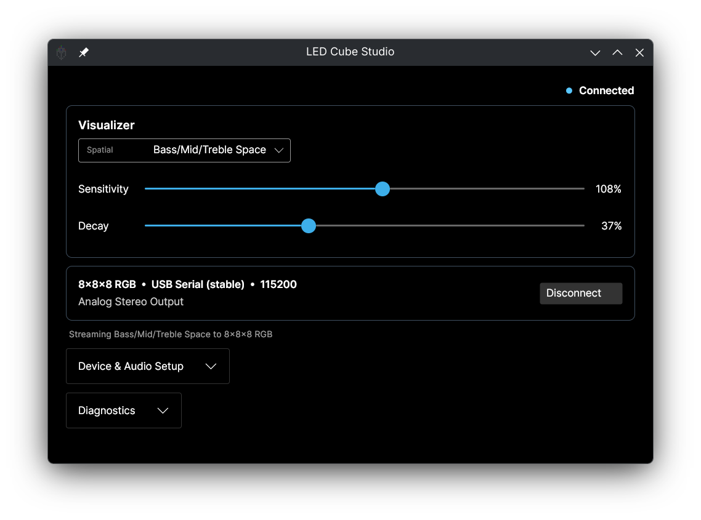
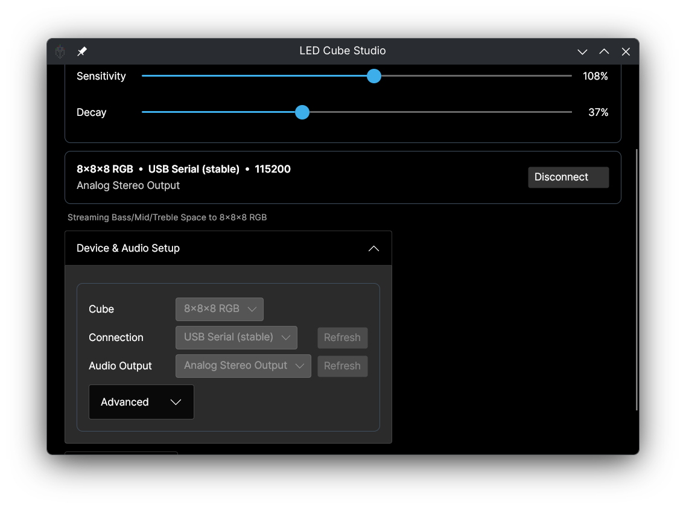

# LED Cube Studio

LED Cube Studio is a cross-platform desktop controller and audio-reactive visualizer for compatible LED cube hardware. This repository is currently a **pre-release / first public release candidate**.



*LED Cube Studio running an audio-reactive visualizer on the connected 8×8×8 RGB cube.*

Current hardware support is focused on the **8×8×8 RGB LED cube**. The application provides native serial communication, audio-output capture, configurable response controls, hardware diagnostics, and a curated collection of three-dimensional visualizers on Linux and Windows.

## Features

- Real-time audio-reactive RGB visualizers
- Native serial-port discovery and communication
- Linux audio capture through PulseAudio or PipeWire-Pulse tools
- Windows audio capture through WASAPI loopback
- Solid-color hardware tests and transport diagnostics
- Self-contained Linux x64 and Windows x64 release packages; no separate .NET installation required

## Screenshots



*Main interface connected to the cube, with visualizer and response controls ready.*



*Device & Audio Setup with cube profile, serial port, and audio source controls.*

## Using a release build

### Linux x64

Install `pactl` and `parec` first. They are commonly provided by `pulseaudio-utils` and work with native PulseAudio or PipeWire-Pulse.

Extract `LED-Cube-Studio-linux-x64.tar.gz`, then run:

```sh
./led-cube-studio
```

The archive is self-contained apart from normal Linux system libraries and the audio tools above. When running from a source checkout, `./packaging/linux/install-user.sh` publishes and installs a desktop entry and icons for the current user. See [Linux packaging](packaging/linux/README.md) for details.

### Windows x64

Extract `LED-Cube-Studio-win-x64.zip` and run `led-cube-studio.exe`. The archive contains the required .NET runtime and native dependencies. Select a Windows audio-render device for WASAPI loopback capture and the COM port associated with the cube.

Windows packaging and its remaining real-machine test requirements are documented in [Windows packaging](packaging/windows/README.md).

## Connecting the cube

1. Connect an already-programmed compatible 8×8×8 RGB cube by USB serial.
2. Select the 8×8×8 RGB profile, serial port, and audio output or monitor source.
3. Choose an audio visualizer or solid-color hardware test.
4. Connect, then adjust sensitivity and decay as needed.

Firmware is **not included**. Hardware and protocol compatibility do not imply ownership or relicensing of the cube's original firmware, software, artwork, or hardware design.

## Development

Install the .NET 8 SDK, then run from the repository root:

```sh
dotnet restore LedCube.CrossPlatform.sln
dotnet test LedCube.CrossPlatform.sln -c Release
dotnet build LedCube.CrossPlatform.sln -c Release
dotnet run --project src/LedCube.App/LedCube.App.csproj
```

Create self-contained packages with:

```sh
./packaging/linux/publish-linux.sh
```

```powershell
./packaging/windows/publish-windows.ps1
```

The supported release targets are Linux x64 and Windows x64. The application targets .NET 8, while published archives include their own runtime. Physical hardware verification still requires a compatible cube and accessible serial device.

## Troubleshooting

- **Linux serial access:** Ensure your user can open the selected `/dev/ttyUSB*`, `/dev/ttyACM*`, or `/dev/serial/by-id/*` device. Depending on the distribution, this commonly requires membership in a group such as `dialout` or `uucp`; sign out and back in after changing group membership.
- **Linux audio source:** Play audio before refreshing sources. Select the monitor corresponding to the active output. Confirm `pactl get-default-sink` works and that `parec` is installed.
- **Windows audio:** Select the output device that is currently playing sound. WASAPI loopback captures rendered output rather than a microphone.
- **Windows serial:** Choose the cube's COM port and close other software that may already have that port open. Reconnect the USB serial device if the port does not appear.

Additional architecture, protocol, and validation notes are available under [docs/](docs/). The operational steps remaining before publication are tracked in the [release checklist](docs/release-checklist.md).

## License

The independently authored LED Cube Studio project code and original branding are licensed under **GPL-3.0-or-later**. See [LICENSE](LICENSE).

Third-party libraries, fonts, and native components retain their own licenses. See [THIRD-PARTY-NOTICES.md](THIRD-PARTY-NOTICES.md) and [licenses/](licenses/).
